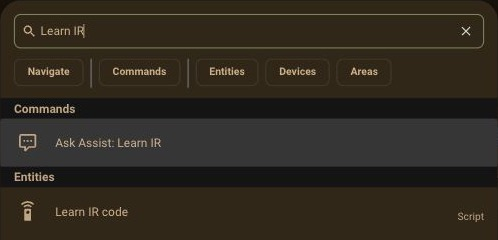
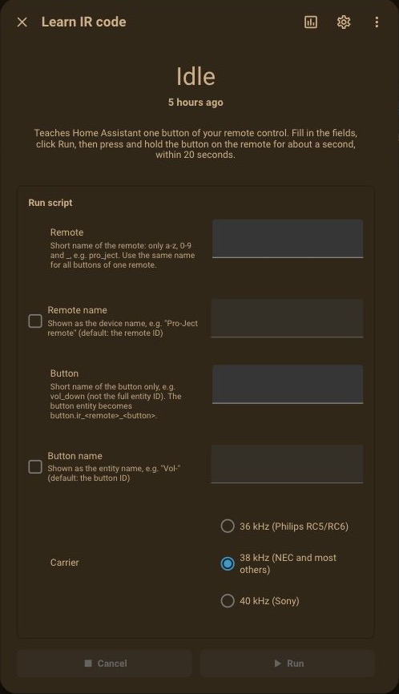
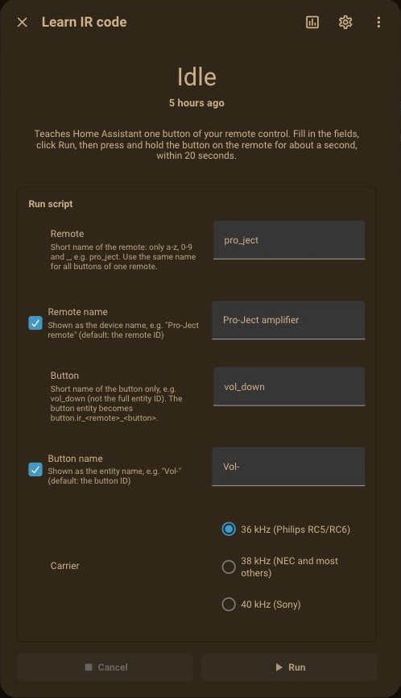
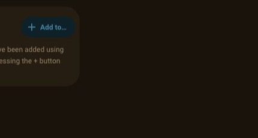
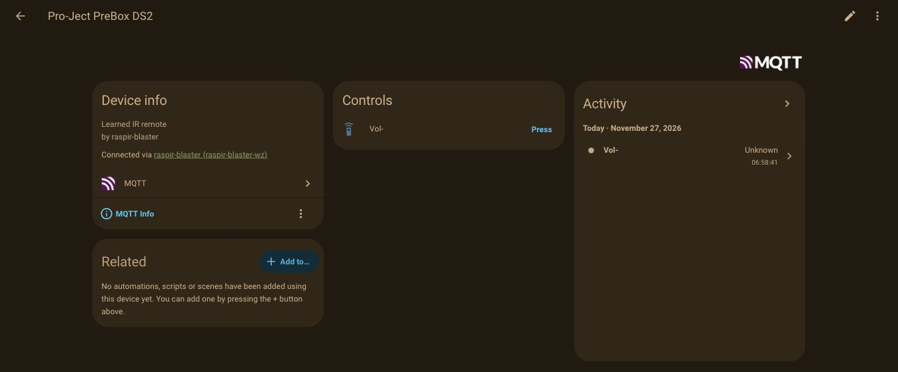
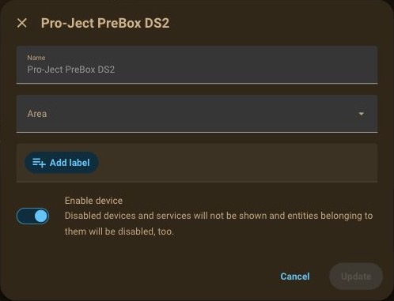
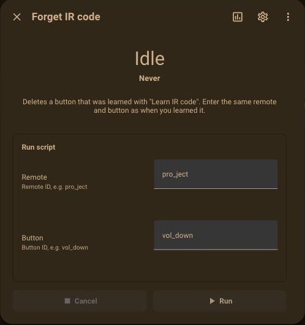
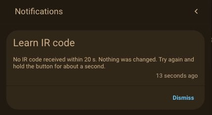

# Teaching Home Assistant your remote controls

Your raspir-blaster can copy the buttons of almost any infrared remote
control: TV, amplifier, air conditioner, LED strip. Once a button is copied,
Home Assistant can press it for you: from your phone, from a dashboard, or
automatically, for example when you leave the house.

This guide shows you, step by step, how to:

1. [Copy a button from your remote](#copy-a-button)
2. [Try it out](#try-it-out)
3. [Put it in a room and on your dashboard](#put-it-in-a-room)
4. [Use it in an automation](#use-it-in-an-automation)
5. [Copy more buttons](#copy-more-buttons)
6. [Replace or delete a button](#replace-or-delete-a-button)

If something doesn't work, see [Problems and solutions](#problems-and-solutions).

## Before you start

You need:

- Your **raspir-blaster**, switched on and set up in Home Assistant.
- The **original remote control** of the device.
- About **1 metre of free line of sight** between the remote and the
  raspir-blaster.
- The two tools **Learn IR code** and **Forget IR code** in Home Assistant.
  If you can't find them in step 1, ask the person who set up your Home
  Assistant to add them.

## Copy a button

In this example we copy the **Vol−** button of a Pro-Ject amplifier remote.

### 1. Open "Learn IR code"

In Home Assistant, click the **magnifying glass** at the top right (or press
**Ctrl + K**, on a Mac **⌘ + K**) and type **Learn IR code**. Click
**Learn IR code** in the list.

A window with a form opens:

### 2. Fill in the form

| Field | What to enter | Example |
| --- | --- | --- |
| **Remote** | A short name for the remote. Use only small letters, digits and `_` (no spaces). Use the same name for every button of this remote. | `pro_ject` |
| **Remote name** | Tick the box and enter the name you want to see in Home Assistant. Anything is allowed here. | `Pro-Ject amplifier` |
| **Button** | A short name for the button, with the same rules as for Remote. Only the button itself, not the remote's name. | `vol_down` |
| **Button name** | Tick the box and enter the name you want to see. | `Vol-` |
| **Carrier** | Depends on the brand of your device, see the table below. If you're not sure, choose **38 kHz**. | 36 kHz |

**Which carrier?**

| Your device is from … | Choose |
| --- | --- |
| Philips, Marantz, Pro-Ject and many other European hi-fi brands | **36 kHz** |
| Samsung, LG and most other TVs, LED strips, most other brands | **38 kHz** |
| Sony | **40 kHz** |
| Don't know | **38 kHz**. If the copied button doesn't work later, copy it again with 36 kHz |

### 3. Click "Run" and press the button on the remote

1. Click **Run** at the bottom of the form.
2. Pick up the remote and point it at the raspir-blaster from about **1 metre**.
3. Within **20 seconds**, **press and hold** the button (here: **Vol−**) for
   **about one second**, then let go.

   A quick tap is often too short. Holding the button for a second works
   reliably.

The bell icon (**Notifications**) at the bottom left shows what to do:

### 4. Done

A few seconds later the notification changes to **Learned**:

The notification also shows the button's internal name, e.g.
`button.ir_pro_ject_vol_down`. You don't need to remember it. You can always
find the button under its own name (here: "Vol-").

If the notification says **No IR code received** instead, nothing has been
changed. Simply try again, see [Problems and solutions](#problems-and-solutions).

## Try it out

1. Go to **Settings → Devices & services → Devices** and open your remote
   (here: **Pro-Ject PreBox DS2**). It's a new device and appears in the list
   with the remote name you entered.
2. Point the raspir-blaster at your device (amplifier, TV, …).
3. Click **Press** next to the button.

Your device should react just as it does to the original remote: here, the
volume goes down by one step.

If nothing happens, see [The device doesn't react](#the-device-doesnt-react).

## Put it in a room

Copied buttons don't belong to a room at first, so they don't appear on room
dashboards yet. To add them:

1. On the remote's device page, click the **pencil** at the top right.
2. Choose a room under **Area**, e.g. *Living room*.
3. Click **Update**.

All buttons of this remote now show up in that room.

**On your own dashboard:** edit the dashboard, click **Add card**, choose the
**Button** card and select the copied button (e.g. "Vol-").

## Use it in an automation

Copied buttons can be pressed by automations, like any other button in Home
Assistant. For example, turn the music down when someone rings the doorbell:

1. **Settings → Automations & scenes → Create automation → Create new
   automation**.
2. **When:** add the trigger *the doorbell rings*.
3. **Then do:** **Add action** → **Button** → **Press**, and select the copied
   button (e.g. "Pro-Ject amplifier Vol-").
4. To go down by several steps, add a **Repeat** action around it, with a
   short **Wait** (0.3 seconds) after each press.
5. **Save**.

## Copy more buttons

Repeat [Copy a button](#copy-a-button) for each button you need, for example
`vol_up`, `mute`, `power`.

Always enter the **same Remote** (here: `pro_ject`). All buttons of a remote
then appear together on one device page.

## Replace or delete a button

**A button doesn't work well:** copy it again with exactly the **same Remote
and Button** names. The new copy replaces the old one, and dashboards and
automations keep working.

**Rename a button or remote:** open it in Home Assistant and change its name
as usual, with the pencil or the settings icon.

**Delete a button:** search for **Forget IR code** (magnifying glass, as in
step 1), enter the **Remote** and **Button** names of the button you want to
delete, and click **Run**. When you delete the last button of a remote, the
remote disappears from Home Assistant too.

## Problems and solutions

### "No IR code received within 20 s"

Nothing was changed. Try again and check:

- Did you **hold** the button for about a second? A quick tap often isn't
  enough.
- Are you about **1 metre** away, pointing the remote **straight** at the
  raspir-blaster? Very close or at an angle can fail.
- Did you press the button **within 20 seconds** after clicking **Run**?
- Are the remote's **batteries** still good?
- Is there bright sunlight or a lamp shining directly at the raspir-blaster?

### "raspir-blaster is offline"

The raspir-blaster is switched off or not connected to your network. Check its
power supply, wait about a minute after switching it on, and try again.

### "Invalid name …"

The **Remote** and **Button** fields only accept small letters, digits and
`_`, with no spaces, capital letters, dots or dashes. Enter only short names,
e.g. Remote `pro_ject` and Button `vol_down`. The display names with spaces
and capital letters go into **Remote name** and **Button name**.

### Nothing happens when I click "Run"

Another copying run is still waiting for a button press (this takes up to 20
seconds). Wait a moment and try again.

### The device doesn't react

- Point the raspir-blaster at the device, from no more than about 2–3 metres.
- Copy the button again with the **other carrier** (36 kHz instead of 38 kHz,
  or the other way round).
- Copy the button again from closer to the raspir-blaster.
- **On/off buttons** (power, mute) of some brands (e.g. Philips, Pro-Ject)
  work only every second time when pressed several times in a row. Copy such a
  button twice under two names (e.g. `power` and `power_2`) and use them
  alternately.

### The button is shown as "unavailable"

The raspir-blaster is switched off or offline. As soon as it's back, the
button works again.

### The copied buttons are gone

Ask the person who looks after your Home Assistant. The copied buttons are
part of a full Home Assistant backup and can be restored from there.
